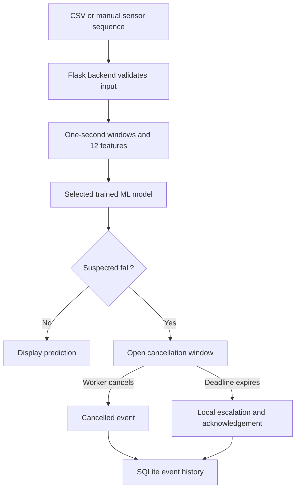

# Edge-Based Fall Detection and Haptic Alert System

A belt-based fall-detection research component for a construction-worker safety system. The software prototype accepts timestamped acceleration and gyroscope readings, extracts movement features, runs trained machine-learning models, and demonstrates an alert cancellation and escalation workflow.

**Current stage:** working software prototype using recorded and manually entered inputs. The physical belt, vibration hardware, on-device inference, and live sensor integration are planned work.

**Author:** Janitha Premachandra

## What the prototype demonstrates

- A Python/Flask backend connected to an HTML, CSS, and JavaScript frontend.
- Sensor input through processed CSV recordings and manually entered sequences.
- Fall-detection experiments using Decision Tree, Random Forest, and Support Vector Machine (SVM) models.
- A model-selector workflow documented in [MODEL_SELECTOR_API.md](FallDetection_Software/MODEL_SELECTOR_API.md).
- Display of prediction results and sensor signals.
- A configurable cancellation window, local alert escalation, and acknowledgement.
- SQLite storage of local event history and CSV export.

The proposed wearable is a **waist-mounted belt**. The current browser interface demonstrates the software workflow; it is not the final mobile application or a deployed hardware safety device.

## Quick start on Windows

Use Python 3.12 or 3.13. Open the repository folder in VS Code, then select **Terminal > New Terminal**. Run the following from the repository root, the folder containing `FallDetection_Software`:

```powershell
python -m venv .venv
.\.venv\Scripts\python.exe -m pip install -r .\FallDetection_Software\requirements.txt
.\.venv\Scripts\python.exe .\FallDetection_Software\app.py
```

Open **[http://127.0.0.1:5050](http://127.0.0.1:5050)** in your browser. Keep the terminal open while using the application. Press **Ctrl+C** to stop it.

If `python` is unavailable but the Windows Python launcher is installed, use `py -3.13 -m venv .venv`, or `py -3.12 -m venv .venv`, for the first command. The remaining commands use the environment directly and do not require PowerShell activation.

The saved models allow inference without retraining. JupyterLab is not required to run the web application. Install the training dependencies below if you want to retrain models or run the full verification suite.

An alternative Windows launcher is available at [start_demo.bat](FallDetection_Software/start_demo.bat). Its environment-detection instructions are described in [START_HERE.txt](FallDetection_Software/START_HERE.txt).

### Try the demo

1. Open the application and load a supplied recording or example sensor sequence.
2. Run the analysis and inspect the backend prediction and signal display.
3. Try a fall example to demonstrate a suspected-fall alert.
4. Cancel the alert while its cancellation window is open.
5. Run a new analysis and allow the cancellation period to expire to demonstrate local escalation and acknowledgement.
6. Inspect the event history or export the stored events.

The supplied walking and fall examples are excerpts from training recordings. They demonstrate the workflow and are not independent evidence of model performance. Manually edited input is synthetic test input, not newly collected research data.

## How the software works



The **one-second analysis window** describes the sensor history used for an ML prediction. The **cancellation window** gives the worker an opportunity to cancel an alert. They are separate concepts. Cancellation time is configurable in the software demonstration.

## Sensor input

The processed input uses the following columns:

```csv
time_s,acc_x_g,acc_y_g,acc_z_g,gyro_x_deg_s,gyro_y_deg_s,gyro_z_deg_s
```

| Column group | Meaning | Unit |
|---|---|---|
| `time_s` | Elapsed time with strictly increasing timestamps | Seconds |
| `acc_x_g`, `acc_y_g`, `acc_z_g` | Three acceleration axes, including gravity | g |
| `gyro_x_deg_s`, `gyro_y_deg_s`, `gyro_z_deg_s` | Three angular-velocity axes | Degrees per second |

An ISO `timestamp` column can be supplied instead of `time_s`. A single row of six sensor values is insufficient: the model needs a timestamped sequence covering at least one second.

The feature-extraction policy uses:

- One-second causal windows: only readings at or before the prediction time are used.
- Candidate endpoints at least 0.25 seconds apart, using the original timestamps.
- At least 10 readings spanning at least 0.8 seconds within an eligible window.
- No gap greater than 0.25 seconds between consecutive readings in a window.
- No interpolation across missing readings or recording boundaries.

Activity labels, participant IDs, filenames, and trial names are not model input features. Raw UP-Fall files must first be converted to the processed belt format.

Example input files: [walking_window.csv](FallDetection_Software/examples/walking_window.csv) and [fall_window.csv](FallDetection_Software/examples/fall_window.csv).

## The 12 model features

For every window, Python combines the three acceleration axes into an acceleration magnitude and the three gyroscope axes into an angular-speed magnitude. It then calculates these features in [`core.py`](FallDetection_Software/core.py):

| Feature | Description |
|---|---|
| `acc_mean` | Mean acceleration magnitude |
| `acc_std` | Population standard deviation of acceleration magnitude |
| `acc_min` | Minimum acceleration magnitude |
| `acc_max` | Maximum acceleration magnitude |
| `acc_range` | Maximum minus minimum acceleration magnitude |
| `gyro_mean` | Mean angular-speed magnitude |
| `gyro_std` | Population standard deviation of angular-speed magnitude |
| `gyro_max` | Maximum angular-speed magnitude |
| `tilt_change` | Angle in radians between the first and last acceleration vectors |
| `acc_last` | Acceleration magnitude at the end of the window |
| `gyro_last` | Angular-speed magnitude at the end of the window |
| `acc_diff_max` | Largest absolute difference between consecutive acceleration magnitudes |

`tilt_change` is an acceleration-direction feature, not a direct measurement of body orientation. `acc_diff_max` is a difference between consecutive samples, not a time-normalised jerk measurement. The same feature definitions are used during training and prediction.

## Dataset and preparation

This prototype uses the belt IMU channels from the public **UP-Fall Detection Dataset**. The original dataset includes multiple sensor locations and camera data; this component uses the belt's three acceleration and three gyroscope axes.

The prepared prototype subset contains **66 recordings**: participants 1–6, all 11 activities, and trial 1 only. It is a subset of UP-Fall, not the entire dataset.

| Purpose | Participants |
|---|---|
| Training | Subjects 1, 2, and 3 |
| Validation and parameter selection | Subject 4 |
| Original Decision Tree test / later reused comparison set | Subjects 5 and 6 |

Participant separation occurs before overlapping windows are extracted, so adjacent windows from a recording do not cross between these splits.

For labelled windows, the activity tag at the window endpoint determines the target: tags 1–5 represent falls, and tags 6–11 represent non-fall activities. A fall trial can also contain standing or lying frames; its filename does not make every row a fall. Windows containing unknown activity tags are excluded from labelled training and evaluation.

The recordings are laboratory data, not measurements collected from construction workers at a worksite. Original source links and checksums are recorded in [dataset_sources.json](FallDetection_Software/data/dataset_sources.json); processed-file checksums are recorded in [processed_manifest.json](FallDetection_Software/data/processed_manifest.json).

### Dataset reference

L. Martínez-Villaseñor, H. Ponce, J. Brieva, E. Moya-Albor, J. Núñez-Martínez, and C. Peñafort-Asturiano, [“UP-Fall Detection Dataset: A Multimodal Approach,” *Sensors*, 19(9), 1988, 2019](https://doi.org/10.3390/s19091988).

[Official UP-Fall dataset site](https://sites.google.com/up.edu.mx/har-up/). Follow the dataset provider's access and usage terms and cite the dataset when using it in research. The dataset is third-party work; this repository does not claim ownership of it.

## Models and training

| Model | Training code | Saved model | Learning material |
|---|---|---|---|
| Decision Tree | [train_model.py](FallDetection_Software/train_model.py) | [trained_tree.json](FallDetection_Software/model/trained_tree.json) | [Model report](FallDetection_Software/reports/MODEL_REPORT.md) |
| Random Forest | [train_random_forest.py](FallDetection_Software/train_random_forest.py) | [trained_forest.json](FallDetection_Software/model/trained_forest.json) | [Training notebook](FallDetection_Software/03_Random_Forest_Training.ipynb) |
| Support Vector Machine | [train_svm.py](FallDetection_Software/train_svm.py) | [trained_svm.json](FallDetection_Software/model/trained_svm.json) | [Training notebook](FallDetection_Software/04_SVM_Training.ipynb) |

Install the training dependencies from the repository root:

```powershell
.\.venv\Scripts\python.exe -m pip install -r .\FallDetection_Software\requirements-training.txt
```

Run the command for the model you want to retrain:

```powershell
# Decision Tree
.\.venv\Scripts\python.exe .\FallDetection_Software\train_model.py

# Random Forest
.\.venv\Scripts\python.exe .\FallDetection_Software\train_random_forest.py

# Support Vector Machine
.\.venv\Scripts\python.exe .\FallDetection_Software\train_svm.py
```

Training requires the prepared CSV files in `FallDetection_Software/data/processed/train`, `validation`, and `test`. If those files are absent from a checkout, prepare the UP-Fall subset before retraining. The saved model files alone are not the training dataset.

Retraining replaces the corresponding model and generated reports. Preserve the supplied artifacts if you need to reproduce a particular reported version. Open the training notebooks in VS Code or JupyterLab to study the process cell by cell.

### Evaluation

Use the saved reports for the actual measured results:

- [Decision Tree model report](FallDetection_Software/reports/MODEL_REPORT.md)
- [Random Forest comparison](FallDetection_Software/reports/RANDOM_FOREST_COMPARISON.md)
- [SVM comparison](FallDetection_Software/reports/SVM_COMPARISON.md)
- [Model-selector verification](FallDetection_Software/reports/MODEL_SELECTOR_VERIFICATION.md)

Assess fall precision, recall, F1, missed falls, and false positives alongside accuracy. Window-level results and event-level results describe different outcomes, and overlapping windows are not independent trials.

Subjects 5–6 had already been examined before the later Random Forest and SVM comparisons. Those comparisons are exploratory reused-set results, not new independent final tests. New participants and worksite recordings are needed for further validation. Model scores should not be presented as calibrated real-world fall probabilities.

## Tests

After installing the training dependencies, run the verification suite from the repository root:

```powershell
.\.venv\Scripts\python.exe -m unittest discover -s .\FallDetection_Software\tests -v
```

See [tests](FallDetection_Software/tests/) for the assertions and [verification reports](FallDetection_Software/reports/) for documented checks. Software tests check implementation behaviour; they do not establish real-world fall-detection performance.

## Repository guide

| Location | Purpose |
|---|---|
| `FallDetection_Software/app.py` | Flask backend, prediction requests, event workflow, and local persistence |
| `FallDetection_Software/core.py` | Sensor validation, windowing, shared features, and Decision Tree inference |
| `FallDetection_Software/random_forest.py` | Portable Random Forest inference |
| `FallDetection_Software/svm_model.py` | SVM inference support |
| `FallDetection_Software/templates/` | HTML frontend templates |
| `FallDetection_Software/static/` | CSS, JavaScript, and frontend assets |
| `FallDetection_Software/model/` | Saved trained models |
| `FallDetection_Software/data/processed/` | Prepared sensor recordings, organised by participant split |
| `FallDetection_Software/examples/` | Sample requests and short demonstration CSV sequences |
| `FallDetection_Software/reports/` | Evaluation results, comparison protocols, data-quality checks, and verification |
| `FallDetection_Software/tests/` | Automated verification code |
| `FallDetection_Software/runtime/` | Local application event database, created when the app runs |

Additional guides: [API](FallDetection_Software/API.md), [model-selector API](FallDetection_Software/MODEL_SELECTOR_API.md), [demo script](FallDetection_Software/DEMO_SCRIPT.md), and [software README](FallDetection_Software/README.md).

Keep `FallDetection_Software/runtime/events.sqlite3` and its SQLite companion files out of Git. The application creates the database locally; a populated event-history database is not required in the repository.

## Current scope and next work

The prototype demonstrates frontend/backend connectivity, trained-model inference, and a persistent local alert workflow. Recorded-input analysis and replay are not live sensor acquisition. The on-screen alert represents the proposed haptic prompt; physical vibration and external SMS, email, or emergency-service delivery are not connected.

Planned work includes:

- Assemble the waist-mounted belt with an IMU and vibration actuator.
- Buffer live sensor readings and validate units, axes, timestamps, and placement.
- Evaluate resource requirements before deploying inference on an edge device.
- Integrate fall alerts with the shared project backend and mobile application.
- Validate with additional participants and realistic worksite conditions.

The other team components—fatigue detection, worksite environmental monitoring, and workforce availability—belong to the wider proposed system. This repository documents the fall-detection component.
