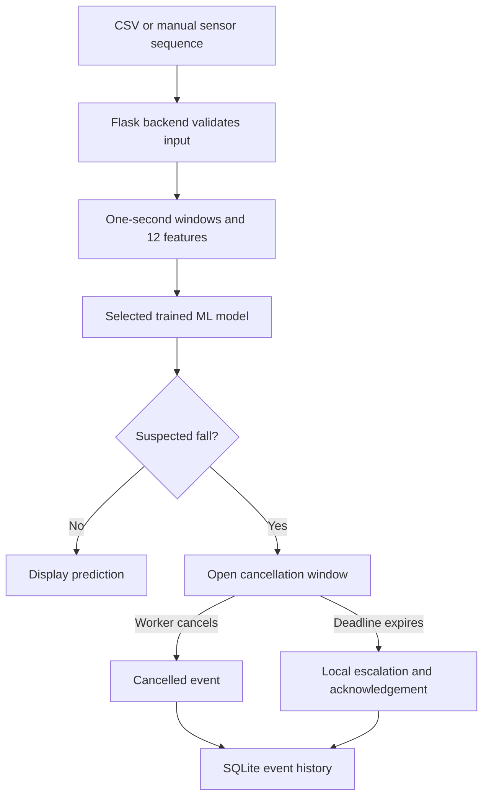

# Edge-Based Fall Detection and Haptic Alert System

A belt-based fall-detection research component for a construction-worker safety system. The software prototype accepts timestamped acceleration and gyroscope readings, extracts movement features, runs trained machine-learning models, and demonstrates an alert cancellation and escalation workflow.

**Current stage:** working software prototype using recorded and manually entered inputs. The physical belt, vibration hardware, on-device inference, and live sensor integration are planned work.

**Author:** Janitha Premachandra

## Contents

- [Quick start](#quick-start-on-windows)
- [Software architecture](#how-the-software-works)
- [Frontend and backend connection](#frontend-and-backend-connection)
- [Sensor input and windows](#sensor-input)
- [The 12 features](#the-12-model-features)
- [Key formulas](#key-formulas)
- [Dataset and participant split](#dataset-and-preparation)
- [API endpoints](#api-endpoints)
- [SQLite database and alerts](#sqlite-database-and-alerts)
- [Models and training](#models-and-training)
- [Evaluation results](#evaluation)
- [Tests](#tests)
- [Repository guide](#repository-guide)
- [Current scope and next work](#current-scope-and-next-work)


## What the prototype demonstrates

- A Python/Flask backend connected to an HTML, CSS, and JavaScript frontend.
- Sensor input through processed CSV recordings and manually entered sequences.
- Fall-detection experiments using Decision Tree, Random Forest, and Support Vector Machine (SVM) models.
- A frontend model selector for Decision Tree, Random Forest, and SVM, with the selected model recorded in predictions and alerts.
- Display of prediction results and sensor signals.
- A configurable cancellation window, local alert escalation, and acknowledgement.
- SQLite storage of local event history and CSV export.

**Technology stack:** Python, Flask, NumPy, pandas, scikit-learn for training, HTML, CSS, JavaScript, and SQLite. Saved-model inference uses the project's portable JSON representations.

The proposed wearable is a **waist-mounted belt**. The current browser interface demonstrates the software workflow; it is not the final mobile application or a deployed hardware safety device.

## Quick start on Windows

Use Python 3.12 or 3.13. Open the repository folder in VS Code, then select **Terminal > New Terminal**. Run the following from the repository root, the folder containing `FallDetection_Software`:

```powershell
python -m venv .venv
.\.venv\Scripts\python.exe -m pip install -r .\FallDetection_Software\requirements.txt
.\.venv\Scripts\python.exe .\FallDetection_Software\app.py
```

Open **[http://127.0.0.1:5050](http://127.0.0.1:5050)** in your browser. Keep the terminal open while using the application. Press **Ctrl+C** to stop it.

If `python` is unavailable but the Windows Python launcher is installed, use `py -3.13 -m venv .venv`, or `py -3.12 -m venv .venv`, for the first command. The remaining commands use the environment directly and do not require PowerShell activation.

The saved models allow inference without retraining. JupyterLab is not required to run the web application. Install the training dependencies below if you want to retrain models or run the full verification suite.

An alternative Windows launcher is available at [start_demo.bat](FallDetection_Software/start_demo.bat). Its environment-detection instructions are described in [START_HERE.txt](FallDetection_Software/START_HERE.txt).

### Try the demo

1. Open the application, choose a prediction model, and load a supplied recording or example sensor sequence.
2. Run the analysis and inspect the backend prediction and signal display.
3. Try a fall example to demonstrate a suspected-fall alert.
4. Cancel the alert while its cancellation window is open.
5. Run a new analysis and allow the cancellation period to expire to demonstrate local escalation and acknowledgement.
6. Inspect the event history or export the stored events.
7. Choose another model and run a new analysis to compare its response to the same sensor input.

The supplied walking and fall examples are excerpts from training recordings. They demonstrate the workflow and are not independent evidence of model performance. Manually edited input is synthetic test input, not newly collected research data.

## How the software works



The **one-second analysis window** describes the sensor history used for an ML prediction. The **cancellation window** gives the worker an opportunity to cancel an alert. They are separate concepts. Cancellation time is configurable in the software demonstration.

## Frontend and backend connection

| File | Responsibility |
|---|---|
| [`templates/index.html`](FallDetection_Software/templates/index.html) | Forms, model selector, prediction display, chart canvas, and alert interface |
| [`static/style.css`](FallDetection_Software/static/style.css) | Colours, typography, spacing, and page layout |
| [`static/app.js`](FallDetection_Software/static/app.js) | Browser interactions, HTTP requests, chart drawing, prediction display, and event polling |
| [`app.py`](FallDetection_Software/app.py) | Flask routes, input handling, model selection, analysis, and database operations |

Flask serves the HTML page at `/` and serves the CSS and JavaScript under `/static/`. No separate frontend server is required for this prototype. The Windows batch launcher starts the Flask application; its startup routine can open the browser.

In `static/app.js`, the `post()` helper prepares JSON requests and the `api()` helper uses `fetch()` to communicate with Flask. For a selected recording, the analysis request includes both the recording ID and selected model ID:

```javascript
result = await post('/api/analyze', {
    sample_id: $('recording').value,
    model_id
});
```

In `app.py`, `@app.post('/api/analyze')` routes that request to `analyze()`. The backend validates the sensor sequence, calls the selected prediction function, stores decisions, and returns JSON. JavaScript reads the response and updates the interface. `/api` is a naming convention for these routes, not a separate folder.

The shared `analyzed()` function selects the model through:

```python
chosen = selected_model(model_id)
active_model = chosen['model']
predictions = chosen['predict'](active_model, frame)
```

## Sensor input

The processed input uses the following columns:

```csv
time_s,acc_x_g,acc_y_g,acc_z_g,gyro_x_deg_s,gyro_y_deg_s,gyro_z_deg_s
```

| Column group | Meaning | Unit |
|---|---|---|
| `time_s` | Elapsed time with strictly increasing timestamps | Seconds |
| `acc_x_g`, `acc_y_g`, `acc_z_g` | Three acceleration axes, including gravity | g |
| `gyro_x_deg_s`, `gyro_y_deg_s`, `gyro_z_deg_s` | Three angular-velocity axes | Degrees per second |

An ISO `timestamp` column can be supplied instead of `time_s`. A single row of six sensor values is insufficient: the model needs a timestamped sequence covering at least one second. Requests are limited to 20,000 rows; the Flask upload limit is 5 MiB, and pasted CSV text is limited to 2,000,000 characters.

The feature-extraction policy uses:

- One-second causal windows: only readings at or before the prediction time are used.
- Candidate endpoints at least 0.25 seconds apart, using the original timestamps.
- At least 10 readings spanning at least 0.8 seconds within an eligible window.
- No gap greater than 0.25 seconds between consecutive readings in a window.
- No interpolation across missing readings or recording boundaries.

Activity labels, participant IDs, filenames, and trial names are not model input features. Raw UP-Fall files must first be converted to the processed belt format.

Example input files: [walking_window.csv](FallDetection_Software/examples/walking_window.csv) and [fall_window.csv](FallDetection_Software/examples/fall_window.csv).

## The 12 model features

For every window, Python combines the three acceleration axes into an acceleration magnitude and the three gyroscope axes into an angular-speed magnitude. It then calculates these features in [`core.py`](FallDetection_Software/core.py):

| Feature | Description |
|---|---|
| `acc_mean` | Mean acceleration magnitude |
| `acc_std` | Population standard deviation of acceleration magnitude |
| `acc_min` | Minimum acceleration magnitude |
| `acc_max` | Maximum acceleration magnitude |
| `acc_range` | Maximum minus minimum acceleration magnitude |
| `gyro_mean` | Mean angular-speed magnitude |
| `gyro_std` | Population standard deviation of angular-speed magnitude |
| `gyro_max` | Maximum angular-speed magnitude |
| `tilt_change` | Angle in radians between the first and last acceleration vectors |
| `acc_last` | Acceleration magnitude at the end of the window |
| `gyro_last` | Angular-speed magnitude at the end of the window |
| `acc_diff_max` | Largest absolute difference between consecutive acceleration magnitudes |

`tilt_change` is an acceleration-direction feature, not a direct measurement of body orientation. `acc_diff_max` is a difference between consecutive samples, not a time-normalised jerk measurement. The same feature definitions are used during training and prediction.

## Key formulas

For reading $i$, acceleration and angular-speed magnitudes are:

$$
A_i = \sqrt{a_{x,i}^2 + a_{y,i}^2 + a_{z,i}^2}, \qquad
G_i = \sqrt{g_{x,i}^2 + g_{y,i}^2 + g_{z,i}^2}
$$

The $g_{x,i}$, $g_{y,i}$, and $g_{z,i}$ terms here denote gyroscope-axis values in degrees per second; acceleration values use g as their unit.

For the $N$ acceleration magnitudes in a window:

$$
\mu_A = \frac{1}{N}\sum_{i=1}^{N} A_i, \qquad
\sigma_A = \sqrt{\frac{1}{N}\sum_{i=1}^{N}(A_i-\mu_A)^2}
$$

The standard-deviation formula uses the population definition, matching `ddof=0`. The code applies the corresponding mean and standard deviation to angular-speed magnitudes as well.

$$
R_A = A_{\max} - A_{\min}, \qquad
D_A = \max_{i=2,\ldots,N}|A_i-A_{i-1}|
$$

These represent acceleration range and the largest consecutive magnitude difference. `tilt_change` is the angle between the first and last acceleration vectors:

$$
\theta = \cos^{-1}\!\left(\frac{\mathbf{a}_1\cdot\mathbf{a}_N}
{\|\mathbf{a}_1\|\,\|\mathbf{a}_N\|}\right)
$$

The implementation clips the cosine input to [-1, 1] and returns zero when the denominator is effectively zero.

The Random Forest's score averages its 100 individual tree scores:

$$
S_{RF} = \frac{1}{100}\sum_{j=1}^{100}s_j
$$

For SVM, feature $k$ is standardised using its training-set mean and standard deviation:

$$
z_k = \frac{x_k-\mu_k^{train}}{\sigma_k^{train}}
$$

`StandardScaler` handles zero-variance features by using a scale of 1. The RBF kernel compares standardised feature vectors, and the decision margin $f(z)$ is converted into a display score:

$$
K(z,z') = \exp\!\left(-\gamma\|z-z'\|^2\right), \qquad
S_{SVM} = \frac{1}{1+\exp(-f(z))}
$$

These scores are uncalibrated. A displayed score such as 70.7% is neither model accuracy nor a validated real-world probability of a fall.

## Dataset and preparation

This prototype uses the belt IMU channels from the public **UP-Fall Detection Dataset**. The original dataset includes multiple sensor locations and camera data; this component uses the belt's three acceleration and three gyroscope axes.

The prepared prototype subset contains **66 recordings**: participants 1–6, all 11 activities, and trial 1 only. It is a subset of UP-Fall, not the entire dataset.

| Purpose | Participants |
|---|---|
| Training | Subjects 1, 2, and 3 |
| Validation and parameter selection | Subject 4 |
| Original Decision Tree test / later reused comparison set | Subjects 5 and 6 |

Participant separation occurs before overlapping windows are extracted, so adjacent windows from a recording do not cross between these splits.

For labelled windows, the activity tag at the window endpoint determines the target: tags 1–5 represent falls, and tags 6–11 represent non-fall activities. A fall trial can also contain standing or lying frames; its filename does not make every row a fall. Windows containing unknown activity tags are excluded from labelled training and evaluation.

The recordings are laboratory data, not measurements collected from construction workers at a worksite. Original source links and checksums are recorded in [dataset_sources.json](FallDetection_Software/data/dataset_sources.json); processed-file checksums are recorded in [processed_manifest.json](FallDetection_Software/data/processed_manifest.json).

### Dataset reference

L. Martínez-Villaseñor, H. Ponce, J. Brieva, E. Moya-Albor, J. Núñez-Martínez, and C. Peñafort-Asturiano, [“UP-Fall Detection Dataset: A Multimodal Approach,” *Sensors*, 19(9), 1988, 2019](https://doi.org/10.3390/s19091988).

[Official UP-Fall dataset site](https://sites.google.com/up.edu.mx/har-up/). Follow the dataset provider's access and usage terms and cite the dataset when using it in research. The dataset is third-party work; this repository does not claim ownership of it.

## API endpoints

Base address while running locally: `http://127.0.0.1:5050`.

| Method | Endpoint | Purpose |
|---|---|---|
| GET | `/api/health` | Backend status, default model, and available model IDs |
| GET | `/api/models` | Available models, names, thresholds, and loading messages |
| GET | `/api/model?model_id=fall-forest-v1` | Selected model metadata and evaluation results |
| GET | `/api/samples` | Available recording IDs, activities, participants, and dataset splits |
| GET | `/api/samples/{sample_id}/csv` | Download sensor-only input for a supplied recording |
| GET | `/api/examples/walking` or `/api/examples/fall` | Demonstration CSV text and source information |
| POST | `/api/analyze` | Analyse all eligible windows in the supplied input |
| POST | `/api/predict` | Return the last eligible window's prediction |
| POST | `/api/events` | Create an alert using a stored positive prediction decision ID |
| GET | `/api/events` | Retrieve the latest 100 events and their transitions |
| POST | `/api/events/{event_id}/cancel` | Cancel a pending event before its deadline |
| POST | `/api/events/{event_id}/acknowledge` | Acknowledge an escalated event |
| GET | `/api/events/export.csv` | Export all stored alert events |

Example analysis request using an included recording:

```json
{
  "model_id": "fall-forest-v1",
  "sample_id": "Subject1Activity1Trial1_belt"
}
```

To try it from PowerShell while Flask is running:

```powershell
$body = @{
    model_id = "fall-forest-v1"
    sample_id = "Subject1Activity1Trial1_belt"
} | ConvertTo-Json

Invoke-RestMethod -Uri "http://127.0.0.1:5050/api/analyze" -Method Post -ContentType "application/json" -Body $body
```

`/api/analyze` also accepts CSV text in a `csv` field, timestamped sensor objects in a `samples` list, or a multipart upload with a `file` field. Multipart uploads pass `model_id` as a separate text field. `/api/predict` accepts a `samples` list and optional `model_id`; a single sensor row does not satisfy its timing requirements.

The default is `fall-tree-v1` when `model_id` is omitted. An unknown or unavailable model returns HTTP 400 instead of silently selecting another one. Predictions and events retain the actual model ID used.

See [API.md](FallDetection_Software/API.md) for the base contract and [MODEL_SELECTOR_API.md](FallDetection_Software/MODEL_SELECTOR_API.md) for model-selection details. The executable endpoints are defined in `app.py`.

## SQLite database and alerts

The `connect()` helper in `app.py` opens the database using:

```python
db = sqlite3.connect(app.config['DATABASE'], timeout=10)
db.row_factory = sqlite3.Row
```

The normal database path is `FallDetection_Software/runtime/events.sqlite3`. The application creates the directory and tables locally; SQLite does not require a separate database server.

| Table | Stored information |
|---|---|
| `decisions` | Prediction decision IDs, run IDs, model IDs, scores, sensor times, and fall flags |
| `events` | Worker labels, originating decisions, cancellation deadlines, model IDs, and current alert states |
| `transitions` | Timestamped alert status changes |

Each analysis run can create one alert, backed by an actual suspected-fall decision. Replay does not create duplicate alerts for that run. A new analysis creates a new run. The available paths are **pending > cancelled**, or **pending > escalated > acknowledged**.

The current demonstration accepts a configurable cancellation time from 1 to 120 seconds, with an initial UI value of 5 seconds. These are implementation settings for the local demo, not a fixed cancellation-time requirement for the proposed wearable. The one-second ML window is unrelated to this cancellation setting.

The backend enforces the stored deadline. Expired events are reconciled when requests invoke the refresh logic; there is no independent notification dispatcher. The browser polls for event changes. A cancelled event remains in history after restart, and changing the selected model cannot change an existing event's recorded model.

Older databases are migrated by adding the model ID column to decisions where needed. Existing rows are retained. The worker ID entered in the interface is a demonstration label, not an authenticated identity. Escalation is to the local backend receiver; no external message is sent.

## Models and training

| Model | Training code | Saved model | Learning material |
|---|---|---|---|
| Decision Tree | [train_model.py](FallDetection_Software/train_model.py) | [trained_tree.json](FallDetection_Software/model/trained_tree.json) | [Model report](FallDetection_Software/reports/MODEL_REPORT.md) |
| Random Forest | [train_random_forest.py](FallDetection_Software/train_random_forest.py) | [trained_forest.json](FallDetection_Software/model/trained_forest.json) | [Training notebook](FallDetection_Software/03_Random_Forest_Training.ipynb) |
| Support Vector Machine | [train_svm.py](FallDetection_Software/train_svm.py) | [trained_svm.json](FallDetection_Software/model/trained_svm.json) | [Training notebook](FallDetection_Software/04_SVM_Training.ipynb) |

### Model selector and selected settings

| Model | Model ID | Selected configuration | Score threshold |
|---|---|---|---:|
| Decision Tree | `fall-tree-v1` | Depth 5, minimum leaf size 5, balanced class weights | 0.65 |
| Random Forest | `fall-forest-v1` | 100 trees, depth 5, minimum leaf size 5, balanced subsample weights | 0.65 |
| SVM | `fall-svm-v1` | RBF kernel, StandardScaler, C=10, gamma=0.1, 550 support vectors, balanced class weights | 0.35 |

The application loads available model files and reports at startup. Restart the backend after retraining or replacing artifacts. If the Random Forest or SVM cannot load, the model-loading messages identify the problem. The selected model appears in the analysis response and stored alert record.

### Where the 12 features enter each model

All three training scripts share the `dataset()` loader from `train_model.py`. It calls `windows()` and `feature_vector()` in `core.py`, then stacks each window's 12 values into a feature matrix. Each row is one window; each column is one feature. The separate target array contains fall/non-fall labels.

| Model | Training call | Prediction implementation |
|---|---|---|
| Decision Tree | `clf.fit(xtrain, ytrain)` | `core.py`: `predict_windows()` and `score_tree()` |
| Random Forest | `clf.fit(xtrain, ytrain)` | `random_forest.py`: `predict_forest()` and `score_forest()` |
| SVM | `clf.fit(ztrain, ytrain)` | `svm_model.py`: `predict_svm()` and `margins_svm()` |

SVM adds training-only standardisation:

```python
scaler = StandardScaler()
ztrain = scaler.fit_transform(xtrain)
zval = scaler.transform(xval)
clf.fit(ztrain, ytrain)
```

Validation and comparison inputs use the already-fitted scaler. The saved SVM includes the means and scales so prediction applies the same transformation. Decision Tree and Random Forest use the original extracted feature values. All three use the same feature definitions and participant split.

The saved JSON files contain learned parameters, such as tree branches or SVM support vectors, rather than training instructions. `app.py` loads and calls the models; training happens in the training scripts.

Install the training dependencies from the repository root:

```powershell
.\.venv\Scripts\python.exe -m pip install -r .\FallDetection_Software\requirements-training.txt
```

Run the command for the model you want to retrain:

```powershell
# Decision Tree
.\.venv\Scripts\python.exe .\FallDetection_Software\train_model.py

# Random Forest
.\.venv\Scripts\python.exe .\FallDetection_Software\train_random_forest.py

# Support Vector Machine
.\.venv\Scripts\python.exe .\FallDetection_Software\train_svm.py
```

Training requires the prepared CSV files in `FallDetection_Software/data/processed/train`, `validation`, and `test`. If those files are absent from a checkout, prepare the UP-Fall subset before retraining. The saved model files alone are not the training dataset.

Retraining replaces the corresponding model and generated reports. Preserve the supplied artifacts if you need to reproduce a particular reported version. Open the training notebooks in VS Code or JupyterLab to study the process cell by cell.

### Evaluation

### Saved comparison results

The saved comparison contains 2,111 windows from subjects 5-6, including 56 fall-labelled windows. The Decision Tree originally used these participants as its held-out test; the subsequent forest and SVM experiments reused them.

| Model | Accuracy | Fall precision | Fall recall | F1 | False-positive windows | Missed fall windows |
|---|---:|---:|---:|---:|---:|---:|
| Decision Tree | 95.88% | 37.40% | 82.14% | 0.514 | 77 | 10 |
| Random Forest | 97.30% | 49.21% | 55.36% | 0.521 | 32 | 25 |
| SVM | 89.01% | 14.23% | 62.50% | 0.232 | 211 | 21 |

All three matched 10 of the 10 tagged fall intervals under the saved event-matching protocol. They produced 15, 4, and 31 false alert groups in non-fall recordings respectively, before cancellation, over about 7.49 minutes of scored non-fall exposure. These event counts differ from window counts and do not establish a reliable operational false-alarm rate.

The forest reduced false-positive windows but missed more fall windows than the Decision Tree. The SVM had lower precision and F1 on this reused set. These results do not identify a model as ready for construction-site deployment.

The interface can display a suspected fall during a non-fall activity such as picking up an object. This is a false positive relative to that activity's ground-truth label. A successful HTTP response confirms that software processed the request, not that the model classified it correctly. Likewise, seven flagged overlapping windows do not represent seven separate falls.

Use the saved reports for the actual measured results:

- [Decision Tree model report](FallDetection_Software/reports/MODEL_REPORT.md)
- [Random Forest comparison](FallDetection_Software/reports/RANDOM_FOREST_COMPARISON.md)
- [SVM comparison](FallDetection_Software/reports/SVM_COMPARISON.md)
- [Model-selector verification](FallDetection_Software/reports/MODEL_SELECTOR_VERIFICATION.md)

Assess fall precision, recall, F1, missed falls, and false positives alongside accuracy. Window-level results and event-level results describe different outcomes, and overlapping windows are not independent trials.

Subjects 5–6 had already been examined before the later Random Forest and SVM comparisons. Those comparisons are exploratory reused-set results, not new independent final tests. New participants and worksite recordings are needed for further validation. Model scores should not be presented as calibrated real-world fall probabilities.

## Tests

After installing the training dependencies, run the verification suite from the repository root:

```powershell
.\.venv\Scripts\python.exe -m unittest discover -s .\FallDetection_Software\tests -v
```

See [tests](FallDetection_Software/tests/) for the assertions and [verification reports](FallDetection_Software/reports/) for documented checks. Software tests check implementation behaviour; they do not establish real-world fall-detection performance.

## Repository guide

| Location | Purpose |
|---|---|
| `FallDetection_Software/app.py` | Flask backend, prediction requests, event workflow, and local persistence |
| `FallDetection_Software/core.py` | Sensor validation, windowing, shared features, and Decision Tree inference |
| `FallDetection_Software/random_forest.py` | Portable Random Forest inference |
| `FallDetection_Software/svm_model.py` | SVM inference support |
| `FallDetection_Software/templates/index.html` | HTML frontend template |
| `FallDetection_Software/static/style.css` | Frontend styling |
| `FallDetection_Software/static/app.js` | Browser interactions, API calls, and result display |
| `FallDetection_Software/model/` | Saved trained models |
| `FallDetection_Software/data/processed/` | Prepared sensor recordings, organised by participant split |
| `FallDetection_Software/examples/` | Sample requests and short demonstration CSV sequences |
| `FallDetection_Software/reports/` | Evaluation results, comparison protocols, data-quality checks, and verification |
| `FallDetection_Software/tests/` | Automated verification code |
| `FallDetection_Software/runtime/` | Local application event database, created when the app runs |

Additional guides: [API](FallDetection_Software/API.md), [model-selector API](FallDetection_Software/MODEL_SELECTOR_API.md), [demo script](FallDetection_Software/DEMO_SCRIPT.md), and [software README](FallDetection_Software/README.md).

Keep `FallDetection_Software/runtime/events.sqlite3` and its SQLite companion files out of Git. The application creates the database locally; a populated event-history database is not required in the repository.

## Troubleshooting

| Symptom | Check |
|---|---|
| Backend unavailable | Keep `app.py` running and open the displayed local address |
| A model is absent from the selector | Inspect `/api/models` loading messages; confirm its JSON, inference code, and report exist; restart Flask |
| No valid one-second window | Check sequence duration, timestamps, sample count, units, missing values, and gaps |
| A non-fall activity triggers an alert | Inspect the model score and ground truth; this may be a classification false positive |
| A new model file is not being used | Restart the backend; models load at startup |
| A cancelled alert is still visible | Cancellation is retained as a history entry; it does not delete the event |

## Current scope and next work

The prototype demonstrates frontend/backend connectivity, trained-model inference, and a persistent local alert workflow. Recorded-input analysis and replay are not live sensor acquisition. The on-screen alert represents the proposed haptic prompt; physical vibration and external SMS, email, or emergency-service delivery are not connected.

Planned work includes:

- Assemble the waist-mounted belt with an IMU and vibration actuator.
- Buffer live sensor readings and validate units, axes, timestamps, and placement.
- Evaluate resource requirements before deploying inference on an edge device.
- Integrate fall alerts with the shared project backend and mobile application.
- Validate with additional participants and realistic worksite conditions.

The other team components—fatigue detection, worksite environmental monitoring, and workforce availability—belong to the wider proposed system. This repository documents the fall-detection component.

